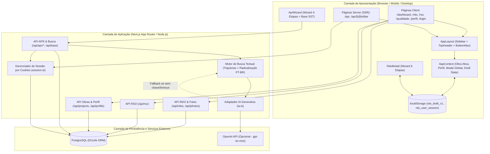
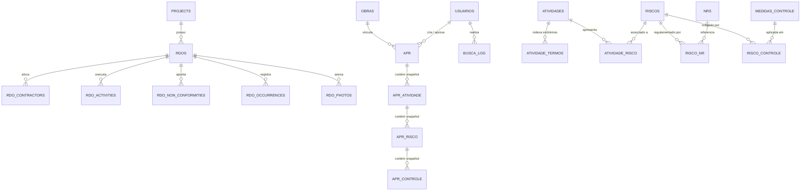
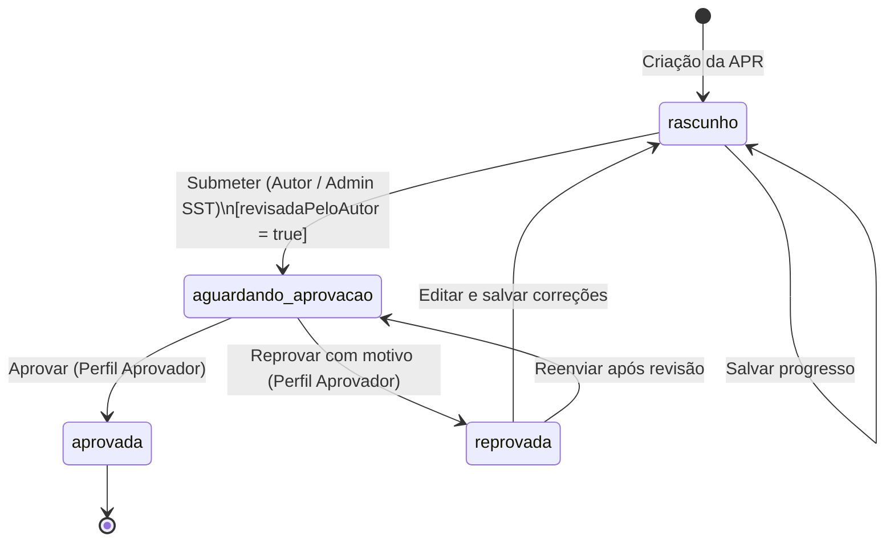
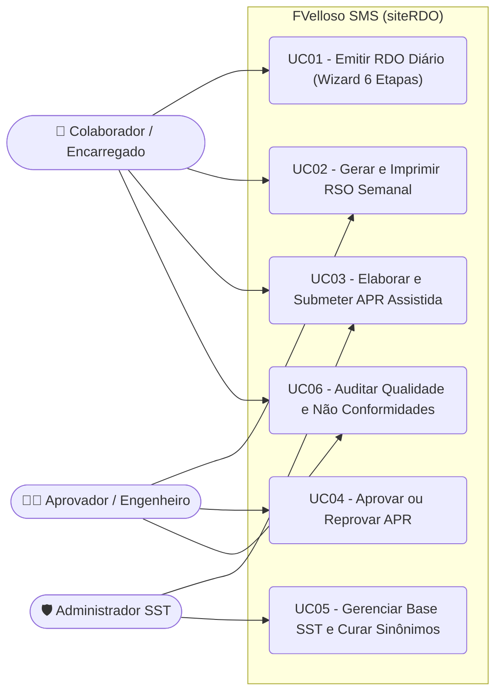

# Especificação Técnica e Funcional — FVelloso SMS (Gestão Tecnológica de Obras)

## 1. Visão Geral do Projeto

O **FVelloso SMS** (`siteRDO`) é uma plataforma web responsiva voltada para a gestão operacional e de Segurança, Meio Ambiente e Saúde (SMS / SST) em canteiros de obras da construção civil. O sistema integra quatro pilares centrais de engenharia de campo:

1. **RDO (Registro Diário de Obra):** Documentação diária de clima, condições de trabalho, efetivo próprio e terceirizado, atividades executadas, horas extras, não conformidades (NRs), ocorrências e evidências fotográficas georreferenciadas/datadas.
2. **RSO (Relatório Semanal de Obra):** Consolidação automática dos indicadores semanais de produção, homens-hora (HH), efetivo médio, frentes terceirizadas, desvios e galeria fotográfica.
3. **APR (Análise Preliminar de Riscos):** Elaboração assistida por busca inteligente (heurística por trigramas/radicais e integração opcional com IA Generativa) para identificação de perigos, avaliação por Matriz de Risco $3 \times 3$, aplicação da Hierarquia de Controles (NR-01) e fluxo formal de revisão e aprovação.
4. **Gestão da Qualidade e Conformidade Técnica:** Monitoramento de apontamentos de campo, conformidade com Normas Regulamentadoras (NR-18, NR-35, NR-10, etc.), ações corretivas e indicadores de resolução.

---

## 2. Arquitetura do Sistema

### 2.1. Stack Tecnológica

| Camada | Tecnologia | Papel no Sistema |
| :--- | :--- | :--- |
| **Framework Full-Stack** | Next.js 16.2.6 (App Router) + React 19.2.6 | Renderização híbrida (Server Components para APR e Client Components para RDO/RSO/Dashboard) e rotas de API REST. |
| **Linguagem** | TypeScript 5.9 | Tipagem estática ponta a ponta (entidades de banco, contratos de API e estados de interface). |
| **Estilização & UI** | Tailwind CSS 4 + Lucide React | Design system responsivo (*mobile-first* para uso em campo com barra inferior flutuante e *sidebar* para desktop). |
| **ORM & Banco de Dados** | Drizzle ORM 0.45 + PostgreSQL (`pg`) | Mapeamento objeto-relacional, transações ACID e queries tipadas em [schema.ts](file:///home/pedro/Documentos/Documentos/siteRDO/src/db/schema.ts). |
| **IA & Busca Textual** | Motor próprio de Trigramas/Stemming + OpenAI API (`gpt-4o-mini`) | Decomposição de descrições de serviço e sugestão de atividades/riscos em [search.ts](file:///home/pedro/Documentos/Documentos/siteRDO/src/lib/apr/search.ts) e [ia.ts](file:///home/pedro/Documentos/Documentos/siteRDO/src/lib/apr/ia.ts). |

### 2.2. Diagrama de Arquitetura de Componentes

### 2.3. Arquitetura de Estado e Persistência Dual

O sistema opera com dois mecanismos complementares de contexto:

1. **Contexto Reativo Global ([`AppProvider`](file:///home/pedro/Documentos/Documentos/siteRDO/src/context/AppContext.tsx#L47-L194)):**
   - Gerencia a obra ativa (`activeProject`), lista de obras (`projects`), perfil do usuário (`profile`), abertura do modal de criação rápida de RDO (`isCreateModalOpen`) e detecção de rascunho local (`hasLocalDraft`).
   - Possui *fallback* resiliente: caso a API `/api/projects` falhe ou o banco esteja vazio, carrega projetos estáticos pré-configurados (`Hotel Marina`, `Smart Fit Leme`, `LMSG Galpão 29`) para garantir operação contínua.
2. **Sessão Server-Side para SST/APR ([`session.ts`](file:///home/pedro/Documentos/Documentos/siteRDO/src/db/session.ts#L1-L70)):**
   - Utiliza cookies HTTP-only (`fv_usuario` e `fv_obra`) gerenciados em [`/api/apr/sessao`](file:///home/pedro/Documentos/Documentos/siteRDO/src/app/api/apr/sessao/route.ts) para determinar o perfil de acesso (`colaborador`, `admin_sst` ou `aprovador`) diretamente nos Server Components e rotas de aprovação.

### 2.4. Modelo de Dados (Diagrama Entidade-Relacionamento)

---

## 3. Requisitos Funcionais (RF)

### Módulo 1: Autenticação, Sessão e Perfil
- **RF01 — Autenticação de Usuário:** O sistema deve permitir o login por e-mail corporativo e senha na rota [`/login`](file:///home/pedro/Documentos/Documentos/siteRDO/src/app/login/page.tsx), registrando a sessão ativa do usuário no navegador (`rdo_user_session`).
- **RF02 — Recuperação de Credenciais:** O sistema deve disponibilizar fluxo de solicitação de redefinição de senha via e-mail corporativo na tela de login.
- **RF03 — Gestão de Perfil do Usuário:** O usuário deve poder visualizar e editar seus dados funcionais (nome completo, CPF, e-mail, celular, data de nascimento, departamento, endereço residencial, foto de avatar em Base64/URL e senha) em [`/perfil`](file:///home/pedro/Documentos/Documentos/siteRDO/src/app/perfil/page.tsx).
- **RF04 — Alternância de Obra Ativa:** O cabeçalho global ([`TopHeader`](file:///home/pedro/Documentos/Documentos/siteRDO/src/components/TopHeader.tsx)) deve permitir selecionar a obra ativa a qualquer momento, recarregando automaticamente os indicadores do Dashboard, RDO e RSO.
- **RF05 — Alternância de Sessão/Perfil SST:** No módulo de APR ([`/api/apr/sessao`](file:///home/pedro/Documentos/Documentos/siteRDO/src/app/api/apr/sessao/route.ts)), o sistema deve suportar a seleção de usuário (com perfis `colaborador`, `admin_sst`, `aprovador`) e obra via cookies de sessão.

### Módulo 2: Dashboard Operacional e Gestão da Qualidade
- **RF06 — Painel Executivo da Obra (Dashboard):** Exibir em [`/dashboard`](file:///home/pedro/Documentos/Documentos/siteRDO/src/app/dashboard/page.tsx) os KPIs consolidados da obra ativa: Homens-Hora (HH) acumulados no mês, efetivo do último RDO (próprios vs. terceiros), total de RDOs registrados, total de ocorrências, condição climática/praticabilidade atual e Índice de Qualidade.
- **RF07 — Gráfico de Efetivo Recente:** Apresentar no Dashboard a distribuição visual diária de operários próprios e terceirizados dos últimos 6 registros, além da tabela dos 5 RDOs mais recentes.
- **RF08 — Painel de Gestão da Qualidade:** Disponibilizar em [`/dashboard/qualidade`](file:///home/pedro/Documentos/Documentos/siteRDO/src/app/dashboard/qualidade/page.tsx) o acompanhamento de não conformidades técnicas e de segurança (NR-18), com filtro por severidade (`Todas`, `Alta`, `Média`, `Baixa`), detalhando o RDO de origem, local, ação corretiva adotada e responsável técnico.

### Módulo 3: RDO (Registro Diário de Obra)
- **RF09 — Listagem e Busca de RDOs:** Permitir listar todos os RDOs da obra ativa em [`/rdo`](file:///home/pedro/Documentos/Documentos/siteRDO/src/app/rdo/page.tsx) com busca instantânea por data, dia da semana, número do RDO ou descrição de atividades.
- **RF10 — Múltiplas Visões de RDO (Lista, Calendário e Histograma):**
  - *Visão Lista:* Cards detalhados com status, clima, efetivo, resumo de atividades e ações rápidas.
  - *Visão Calendário:* Grade mensal interativa indicando dias preenchidos, dias com ocorrências, dias paralisados por chuva e dias sem RDO (permitindo clicar em um dia vazio para lançar o RDO daquela data).
  - *Visão Histograma:* Gráfico de barras horizontais empilhadas comparando equipe própria e empreiteiros por dia.
- **RF11 — Criação e Edição de RDO em 6 Etapas (Wizard):** Disponibilizar modal passo a passo ([`RdoModal`](file:///home/pedro/Documentos/Documentos/siteRDO/src/components/RdoModal.tsx)) contendo:
  1. *Geral:* Data, status do dia (`trabalhando`, `nao_trabalhando`, `paralisado_chuva`), condição da área (`praticavel`, `impraticavel`) e clima manhã/tarde (`sol`, `parcialmente_nublado`, `nublado`, `chuva`).
  2. *Efetivo:* Quantidade de mão de obra própria e lista dinâmica de empreiteiros terceirizados (empresa, especialidade e nº de operários, com sugestões rápidas).
  3. *Não Conformidades:* Apontamentos de desvios com seleção de NR (lista de NRs da construção civil, demais NRs ou customizada), severidade (`baixa`, `media`, `alta`), ação corretiva e status (`resolvido`, `pendente`).
  4. *Atividades:* Lista de serviços executados no dia, frente/local de trabalho, status (`em_andamento`, `concluido`) e indicação de horas extras (`hasOvertime` e quantidade de horas).
  5. *Ocorrências e Observações:* Registro de eventos críticos categorizados (`Geral`, `Acidente`, `Falta de Material`, `Fiscalização`, `Entrega`, `Clima`), horas impactadas e observações gerais do encarregado.
  6. *Fotos de Campo:* Upload de imagens com conversão Base64, vinculação à atividade, registro de boa prática ou não conformidade, legenda, carimbo de data/hora/localização e opção de exibir marca d'água técnica (`showWatermark`).
- **RF12 — Auto-Save de Rascunho Local:** Salvar automaticamente no `localStorage` (`rdo_draft_v1`) cada alteração feita durante a criação de um novo RDO, exibindo alertas visuais no cabeçalho e na listagem para retomar ou descartar o rascunho.
- **RF13 — Visualização Detalhada, Impressão e Exclusão de Fotos/RDO:** Permitir abrir o modal [`RdoDetailModal`](file:///home/pedro/Documentos/Documentos/siteRDO/src/components/RdoDetailModal.tsx), excluir fotos individuais com confirmação, imprimir/exportar PDF via diálogo nativo (`window.print()`) e excluir o RDO mediante confirmação textual obrigatória (`EXCLUIR`).

### Módulo 4: RSO (Relatório Semanal de Obra)
- **RF14 — Consolidação Automática Semanal:** Agregar automaticamente em [`/rso`](file:///home/pedro/Documentos/Documentos/siteRDO/src/app/rso/page.tsx) (via [`/api/rso`](file:///home/pedro/Documentos/Documentos/siteRDO/src/app/api/rso/route.ts)) todos os RDOs compreendidos entre a segunda-feira e o domingo da semana selecionada, calculando: total de RDOs, dias trabalhados vs. paralisados, soma de HH semanal, efetivo médio diário, atividades consolidadas, frentes terceirizadas únicas, ocorrências e galeria fotográfica da semana.
- **RF15 — Navegação Temporal e Registro Manual de RSO:** Permitir navegar entre semanas anteriores/posteriores, emitir impressão/PDF do relatório consolidado e abrir modal para lançamento de RSO Manual.

### Módulo 5: APR (Análise Preliminar de Riscos) e Base de Conhecimento SST
- **RF16 — Listagem e Filtragem Avançada de APRs:** Exibir em [`/apr`](file:///home/pedro/Documentos/Documentos/siteRDO/src/app/apr/page.tsx) os contadores por status (`Rascunho`, `Aguardando aprovação`, `Aprovada`, `Reprovada / devolvida`) e filtrar por termo livre (código, local, descrição), obra, situação, atividade e intervalo de datas.
- **RF17 — Busca Inteligente de Atividades e Riscos:** Ao descrever o serviço na criação da APR ([`/api/apr/busca`](file:///home/pedro/Documentos/Documentos/siteRDO/src/app/api/apr/busca/route.ts)), decompor o texto em trechos e sugerir atividades da Base de Conhecimento SST ranqueadas por relevância (`alta`, `possivel`, `baixa`), carregando automaticamente seus riscos típicos, NRs associadas e medidas de controle.
- **RF18 — Interpretação Assistida por IA (Opcional):** Quando a variável de ambiente `OPENAI_API_KEY` estiver configurada, utilizar o modelo `gpt-4o-mini` ([`interpretarComIa`](file:///home/pedro/Documentos/Documentos/siteRDO/src/lib/apr/ia.ts#L7-L45)) para extrair atividades distintas de descrições complexas em linguagem natural, com *fallback* transparente para decomposição heurística local.
- **RF19 — Elaboração de APR em 4 Etapas ([`AprWizard`](file:///home/pedro/Documentos/Documentos/siteRDO/src/components/apr/AprWizard.tsx)):**
  1. *Identificação e Busca:* Obra, local/frente, responsável, equipe, data de execução, descrição do serviço e seleção de atividades sugeridas ou adição manual.
  2. *Avaliação de Riscos:* Revisão individual de cada risco por atividade, ajuste de Probabilidade (`baixa`, `media`, `alta`) e Severidade (`leve`, `moderada`, `grave`), cálculo automático do Nível de Risco e inclusão de riscos da base ou manuais.
  3. *Medidas de Controle:* Seleção de controles organizados pela Hierarquia de Controles (`Eliminação`, `Substituição`, `Engenharia`, `Administrativo`, `EPI`), adição de controles extras e exigência de justificativa caso uma medida obrigatória seja desmarcada.
  4. *Resumo e Declaração de Revisão:* Conferência integral do documento, marcação do aceite de revisão técnica pelo autor (`revisadaPeloAutor`) e envio para aprovação.
- **RF20 — Fluxo de Aprovação e Reprovação de APR:** Permitir que usuários com perfil `aprovador` aprovem ou reprovem (com motivo obrigatório) APRs no status `aguardando_aprovacao` ([`/api/apr/[id]/acao`](file:///home/pedro/Documentos/Documentos/siteRDO/src/app/api/apr/[id]/acao/route.ts)).
- **RF21 — Gestão da Base de Conhecimento SST e Curadoria de Buscas:** Permitir exclusivamente ao perfil `admin_sst` ([`BaseConhecimento.tsx`](file:///home/pedro/Documentos/Documentos/siteRDO/src/components/apr/BaseConhecimento.tsx) e [`/api/base`](file:///home/pedro/Documentos/Documentos/siteRDO/src/app/api/base/route.ts)) cadastrar/editar atividades, sinônimos de busca, riscos, vínculos com NRs e medidas de controle, além de revisar logs de buscas insatisfatórias (`busca_log`) convertendo termos reais buscados pelos usuários em novos sinônimos indexados.

---

## 4. Requisitos Não Funcionais (RNF)

- **RNF01 — Responsividade e Ergonomia Mobile-First:** A interface deve adaptar-se a telas de smartphones (uso em campo com barra de navegação inferior [`BottomNav`](file:///home/pedro/Documentos/Documentos/siteRDO/src/components/BottomNav.tsx) e botão de ação flutuante central) e desktops (menu lateral fixo [`Sidebar`](file:///home/pedro/Documentos/Documentos/siteRDO/src/components/Sidebar.tsx) e tabelas expandidas).
- **RNF02 — Tolerância a Falhas e Persistência Offline de Rascunho:** O preenchimento de RDO não pode ser perdido em caso de fechamento acidental da aba ou queda momentânea de conexão, sendo sincronizado em tempo real no `localStorage` do dispositivo.
- **RNF03 — Acessibilidade Visual na Matriz de Risco:** Os níveis de risco da APR não devem depender exclusivamente de cores; devem exibir sempre rótulo textual e algarismo romano (`I - Baixo`, `II - Moderado`, `III - Alto`, `IV - Crítico`), conforme implementado em [`risco.ts`](file:///home/pedro/Documentos/Documentos/siteRDO/src/lib/apr/risco.ts#L24-L30).
- **RNF04 — Integridade Transacional e Imutabilidade Histórica (Snapshot):** A gravação de APRs e itens da base SST deve ocorrer dentro de transações de banco de dados (`db.transaction`). Os itens da APR devem ser gravados como *snapshots* textuais (`atividadeNomeSnapshot`, `riscoNomeSnapshot`, `controleNomeSnapshot`) para que alterações futuras na Base de Conhecimento não adulterem APRs já emitidas ou aprovadas.
- **RNF05 — Timeout e Degradação Graciosa de IA:** A chamada à API da OpenAI possui limite estrito de *timeout* de `6000ms` (`AbortController`) e temperatura `0`. Em caso de indisponibilidade, lentidão ou ausência de chave, o motor heurístico local assume sem interromper a operação do usuário.
- **RNF06 — Desempenho de Busca em Memória:** A indexação e busca por similaridade de trigramas e radicalização em português ([`search.ts`](file:///home/pedro/Documentos/Documentos/siteRDO/src/lib/apr/search.ts)) deve executar em memória no servidor sem depender de extensões externas do banco, retornando sugestões em milissegundos.

---

## 5. Regras de Negócio (RN)

### 5.1. Regras do RDO e RSO
- **RN01 — Numeração Sequencial por Obra:** Cada novo RDO recebe automaticamente o número sequencial `max(rdoNumber) + 1` dentro do escopo exclusivo daquela obra (`projectId`), iniciando em `1` ([`api/rdos/route.ts`](file:///home/pedro/Documentos/Documentos/siteRDO/src/app/api/rdos/route.ts#L96-L104)).
- **RN02 — Cálculo Automático de Homens-Hora (HH):**
  - Efetivo Total:
    $$\text{Total Operários} = \text{Equipe Própria} + \sum \text{Operários de Empreiteiros}$$
  - Jornada Padrão conforme status do dia (`dayStatus`):
    - `trabalhando` = $8\text{ horas}$
    - `paralisado_chuva` = $4\text{ horas}$
    - `nao_trabalhando` = $0\text{ horas}$
  - Se houver operários ($\text{Total Operários} > 0$), soma-se o total de horas extras (`overtimeHours`) das atividades marcadas com `hasOvertime`:
    $$\text{HH Total} = (\text{Total Operários} \times \text{Jornada Padrão}) + \sum \text{Horas Extras}$$
- **RN03 — Cálculo do Índice de Qualidade no Dashboard:** O indicador percentual de qualidade da obra parte de $100\%$ e sofre dedução de $2{,}5\%$ para cada RDO com ocorrência registrada no período, respeitando o piso mínimo de $88\%$ ([`dashboard/page.tsx`](file:///home/pedro/Documentos/Documentos/siteRDO/src/app/dashboard/page.tsx#L60)):
  $$\text{Score de Qualidade} = \max(88,\; 100 - 2{,}5 \times N_{\text{ocorrências}})$$
- **RN04 — Validação Mínima para Emissão de RDO:** Um RDO só pode ser finalizado se possuir data preenchida (Etapa 1) e ao menos uma atividade com descrição válida informada (Etapa 4).
- **RN05 — Confirmação Forte para Exclusão de RDO:** Para evitar perda acidental de registros de engenharia, a exclusão de um RDO exige que o usuário digite explicitamente a palavra `"EXCLUIR"` no modal de confirmação ([`ConfirmModal`](file:///home/pedro/Documentos/Documentos/siteRDO/src/app/rdo/page.tsx#L680-L689)).

### 5.2. Regras da APR e Segurança do Trabalho (SST)
- **RN06 — Geração de Código Único de APR:** Toda APR criada recebe um código padronizado no formato `APR-AAAA-NNNN` (ex.: `APR-2026-0001`), sequencial por ano civil, com verificação anti-colisão em até 3 tentativas dentro da transação ([`repo.ts`](file:///home/pedro/Documentos/Documentos/siteRDO/src/lib/apr/repo.ts#L284-L291)).
- **RN07 — Matriz de Risco $3 \times 3$ (Probabilidade $\times$ Severidade):**
  - Pesos atribuídos:
    - **Probabilidade ($P$):** `baixa` = $1$, `media` = $2$, `alta` = $3$
    - **Severidade ($S$):** `leve` = $1$, `moderada` = $2$, `grave` = $3$
  - Produto $V = P \times S$:
    - $V \le 2 \Rightarrow$ **Nível I — Baixo**
    - $3 \le V \le 4 \Rightarrow$ **Nível II — Moderado**
    - $5 \le V \le 6 \Rightarrow$ **Nível III — Alto**
    - $V = 9 \Rightarrow$ **Nível IV — Crítico**
- **RN08 — Regras de Validação por Etapa da APR ([`validacao.ts`](file:///home/pedro/Documentos/Documentos/siteRDO/src/lib/apr/validacao.ts)):**
  - *Etapa 1:* Local da obra, responsável, data de execução e descrição do serviço (mínimo de 10 caracteres) são obrigatórios.
  - *Etapa 2:* Deve haver ao menos 1 atividade selecionada; todos os riscos sugeridos devem ser marcados como revisados (`revisado = true`); cada atividade deve ter ao menos 1 risco aplicável selecionado.
  - *Etapa 3:* Todo risco selecionado deve possuir pelo menos 1 medida de controle ativa; se uma medida classificada na base como **obrigatória** (`obrigatorio = true`) for desmarcada pelo usuário, é **obrigatório** preencher o campo de justificativa técnica.
- **RN09 — Máquina de Estados e Bloqueio de Edição da APR:**
  - Uma APR em status `aguardando_aprovacao` ou `aprovada` é **bloqueada para edição** (tanto na API quanto via redirecionamento automático em [`/apr/[id]/editar`](file:///home/pedro/Documentos/Documentos/siteRDO/src/app/apr/[id]/editar/page.tsx#L14)).
  - Se uma APR estiver `reprovada` e for editada/salva pelo autor, ela retorna automaticamente ao status `rascunho` para nova revisão e submissão.

- **RN10 — Controle de Acesso Baseado em Perfil (RBAC SST):**
  - **Colaborador (`colaborador`):** Cria e edita rascunhos de APR e submete apenas APRs de sua própria autoria.
  - **Administrador SST (`admin_sst`):** Pode submeter APRs e possui permissão exclusiva para gerenciar a Base de Conhecimento SST (`/api/base`) e curar termos de busca.
  - **Aprovador (`aprovador`):** Único perfil autorizado a executar as transições `aprovar` e `reprovar` em APRs pendentes.
- **RN11 — Algoritmo de Pontuação e Limiares de Busca (`search.ts`):**
  - Frase exata encontrada ($\ge 4$ caracteres) = score `1.0`.
  - Cobertura de tokens radicalizados + aproximação por trigramas ($\ge 0.5$) ponderada por tamanho da expressão (`0.75` para termo simples, `0.95` para expressão composta) + bônus de evidência acumulada (até `+0.15`).
  - **Limiar de Exibição:** score $\ge 0{,}14$.
  - **Limiar de Busca Satisfatória:** score $\ge 0{,}32$ (buscas abaixo desse valor são registradas como `satisfatoria = false` em `busca_log` para curadoria do Administrador SST).
  - **Classificação de Relevância:** `alta` ($\ge 0{,}60$), `possivel` ($\ge 0{,}32$), `baixa` ($< 0{,}32$).

---

## 6. Casos de Uso (UC)

### Diagrama Geral de Casos de Uso

---

### UC01 — Emitir Registro Diário de Obra (RDO)
- **Ator Principal:** Encarregado Geral / Engenheiro de Campo.
- **Pré-condições:** Obra ativa selecionada no sistema.
- **Fluxo Principal:**
  1. O usuário aciona o botão **"Novo RDO"** (no Dashboard, na listagem de RDO, no calendário ou no botão flutuante mobile).
  2. O sistema abre o `RdoModal` na Etapa 1 (Geral) com a data atual (ou data clicada no calendário) e restaura eventual rascunho salvo no `localStorage`.
  3. O usuário define o status do dia, condição do canteiro e clima manhã/tarde.
  4. Na Etapa 2 (Efetivo), informa o número de operários próprios e adiciona as empresas terceirizadas e seus efetivos.
  5. Na Etapa 3 (Não Conformidades), registra eventuais desvios de segurança/qualidade vinculando a NR correspondente, severidade e ação corretiva.
  6. Na Etapa 4 (Atividades), descreve os serviços executados, locais, status e horas extras.
  7. Na Etapa 5 (Ocorrências), registra paralisações ou intercorrências e observações gerais.
  8. Na Etapa 6 (Fotos), anexa fotos de campo com carimbo técnico automático e seleciona **"Finalizar RDO"**.
  9. O sistema calcula o número sequencial do RDO e o total de HH, persiste os dados em banco, limpa o rascunho local (`rdo_draft_v1`) e atualiza os indicadores.
- **Fluxos Alternativos / Exceções:**
  - *A1 — Interrupção do Preenchimento:* Se o usuário fechar o modal antes de finalizar, o sistema mantém o rascunho salvo no navegador e exibe um banner âmbar *"Rascunho em andamento"* para retomada futura.
  - *E1 — Sem atividade informada:* Caso tente salvar sem nenhuma atividade na Etapa 4, o sistema exibe alerta e redireciona o usuário para a Etapa 4.
- **Pós-condições:** RDO gravado com status `concluido`, visível na lista, no calendário mensal, no histograma de mão de obra e contabilizado no RSO.

---

### UC02 — Consultar e Emitir Relatório Semanal de Obra (RSO)
- **Ator Principal:** Encarregado Geral / Engenheiro / Gestor.
- **Pré-condições:** Existência de obra ativa selecionada.
- **Fluxo Principal:**
  1. O usuário acessa o menu **RSO** (`/rso`).
  2. O sistema identifica o intervalo da semana corrente (segunda a domingo) e consulta `/api/rso`.
  3. O sistema apresenta os cartões de KPI semanais (RDOs emitidos, dias trabalhados vs. paralisados, soma de HH, média de operários/dia e total de ocorrências), lista consolidada de atividades, frentes terceirizadas ativas e galeria de fotos da semana.
  4. O usuário clica em **"Imprimir / PDF"** para gerar a versão física/digital do relatório semanal.
- **Fluxos Alternativos:**
  - *A1 — Navegação entre semanas:* O usuário utiliza os controles de paginação semanal (`Semana anterior` / `Próxima`) para auditar períodos passados.
  - *A2 — Lançamento Manual:* Caso não haja RDOs no período, o usuário pode acionar o botão **"Manual"** para registrar um resumo semanal avulso.

---

### UC03 — Elaborar e Submeter Análise Preliminar de Riscos (APR)
- **Ator Principal:** Colaborador / Técnico de Segurança / Encarregado.
- **Pré-condições:** Obra e usuário identificados na sessão SST.
- **Fluxo Principal:**
  1. Na página `/apr`, o usuário clica em **"Nova APR"**.
  2. **Etapa 1 (Serviço e Atividades):** Preenche local da obra, responsável, equipe, data prevista e digita a descrição detalhada do serviço (ex.: *"Montagem de andaime fachadeiro e instalação elétrica provisória"*).
  3. O usuário aciona a busca inteligente; o sistema decompõe a descrição (via IA ou heurística local), retorna as atividades compatíveis da Base SST e o usuário seleciona as aplicáveis.
  4. **Etapa 2 (Riscos):** O sistema carrega automaticamente os riscos e NRs de cada atividade selecionada. O usuário avalia cada risco (ajustando Probabilidade e Severidade na Matriz $3 \times 3$) e confirma sua revisão (`revisado = true`).
  5. **Etapa 3 (Controles):** O sistema exibe as medidas preventivas agrupadas pela Hierarquia de Controles. O usuário confirma os controles aplicáveis ou adiciona medidas complementares.
  6. **Etapa 4 (Resumo e Envio):** O usuário confere o quadro completo da APR, marca a declaração de revisão pelo autor e clica em **"Enviar para aprovação"**.
- **Fluxos Alternativos / Exceções:**
  - *A1 — Remoção de Controle Obrigatório:* Se o usuário desmarcar um controle marcado como obrigatório na base SST, o sistema exige o preenchimento de justificativa técnica antes de avançar.
  - *A2 — Salvar como Rascunho:* O usuário pode salvar a APR a qualquer momento como `rascunho` para continuar posteriormente.
- **Pós-condições:** APR persistida com *snapshot* completo de atividades, riscos e controles, e status alterado para `aguardando_aprovacao`.

---

### UC04 — Aprovar ou Reprovar APR
- **Ator Principal:** Aprovador (`perfil = "aprovador"`).
- **Pré-condições:** APR no status `aguardando_aprovacao` e usuário logado com perfil `aprovador`.
- **Fluxo Principal (Aprovação):**
  1. O Aprovador acessa a APR pendente em `/apr/[id]`.
  2. Analisa a matriz de riscos, NRs vinculadas, medidas de controle e eventuais justificativas de remoção de controle obrigatório.
  3. Clica em **"Aprovar APR"**.
  4. O sistema valida o perfil do usuário, registra `aprovadoPor` e `aprovadoEm`, altera o status para `aprovada` e bloqueia definitivamente qualquer edição futura.
- **Fluxo Alternativo (Reprovação / Devolução):**
  1. O Aprovador identifica falhas na análise de risco, clica em **"Reprovar / Devolver"** e informa obrigatoriamente o motivo técnico da reprovação.
  2. O sistema altera o status para `reprovada`, desmarca `revisadaPeloAutor` e exibe o parecer de reprovação para que o autor realize os ajustes.

---

### UC05 — Gerenciar Base de Conhecimento SST e Curar Buscas
- **Ator Principal:** Administrador SST (`perfil = "admin_sst"`).
- **Pré-condições:** Usuário autenticado na sessão com perfil `admin_sst`.
- **Fluxo Principal:**
  1. O Administrador SST acessa a interface de **Base de Conhecimento** na área de APR.
  2. Cadastra ou atualiza **Atividades** (com categoria e sinônimos de busca), **Riscos** (vinculando NRs e controles obrigatórios/recomendados) e **Medidas de Controle** (classificadas na hierarquia da NR-01).
  3. Na aba de **Buscas sem correspondência satisfatória** (`busca_log`), visualiza termos reais digitados em campo que tiveram score $< 0{,}32$.
  4. Vincula o termo buscado como novo sinônimo de uma atividade existente ou marca a busca como revisada.
- **Pós-condições:** Base de conhecimento atualizada para futuras APRs, sem alterar o conteúdo histórico (*snapshot*) das APRs já emitidas.
